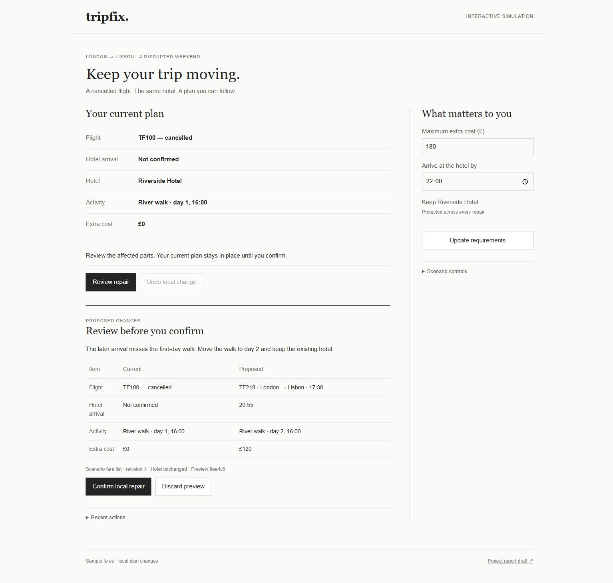
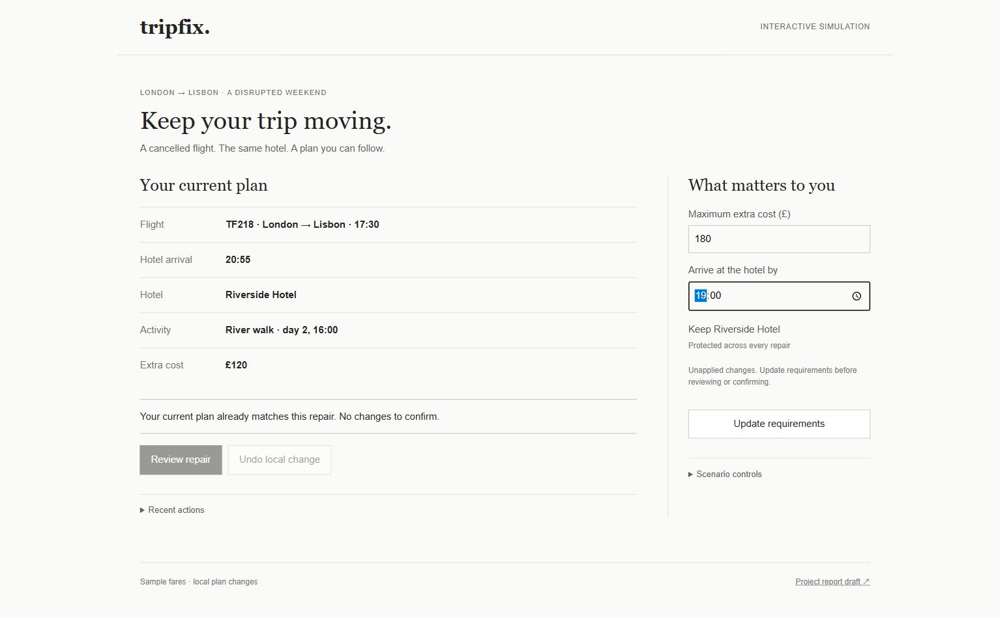
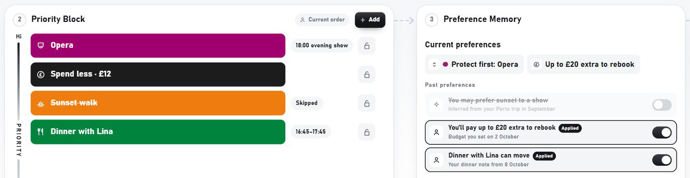

# TripFix

README prose word count: 539

A cancelled train can leave three activities on the calendar and still cost a traveller the one they came for. TripFix lets the traveller choose what to protect, inspect the preferences behind a proposed repair and approve the changes.

## Start here · Current A2 demo

[Download the project ZIP](https://github.com/THRIDX/TripFix/archive/refs/heads/main.zip), extract it, and open `TripFix/index.html` in your browser. Select **English**, then **Start demo**. The [project report (PDF)](TripFix/TripFix_A2_Project_Report.pdf) follows this version.

To serve the same demo with Python 3, run this from the repository root:

```sh
python -m http.server 8788 --bind 127.0.0.1 --directory TripFix
```

Open the [English demo](http://127.0.0.1:8788/#en) and select **Start demo** on the Birmingham to London trip. No installation or API key is required if Python and a modern browser are available.

## Replay the London decision

1. After the cancellation, drag **Opera** first and **Spend less** second in **Priority Block**. Choose **Finish ranking**. In **Preference Memory**, the inferred sunset preference switches off and the £20 budget stays on.
2. Choose **See proposed changes**. Check the 13:30 train, dinner at 16:45, the full 18:00 opera and the skipped walk. The additional cost is £12. Leave this proposal open for the next check.
3. Lock both **Opera** and **Spend less**. Confirmation is blocked. Unlock only **Opera**. Entry at the 15:45 interval now costs £0 and can be confirmed. **Replay** resets the itinerary and keeps the trip’s preferences.

## What runs

HTML and CSS present the itinerary and controls. A JavaScript planner searches train and activity combinations, enforces locks and compares feasible plans in the traveller’s chosen order. Browser storage retains settings per trip. The cancellation, fares, historical preferences and external booking or messaging effects are simulated. The demo runs locally without a language model. Live provider integration is outside its scope. Testing whether travellers understand the trade-offs remains future work.

## Development and ownership

- **From a list to a choice.** The [first prototype](https://github.com/THRIDX/TripFix/commit/fecee9653790bb0a422fb6dabc4aa9f46906f165) listed current and proposed changes. It could show a moved activity, but the traveller had no way to say which one mattered most. I introduced draggable priorities and separate locks so a preference could be distinguished from a firm requirement. The [interaction implementation](https://github.com/THRIDX/TripFix/commit/82dc02b3af5b080f1bdea3720f7100df071f49ca) connects both controls to the planner.

| First prototype: proposed changes | Following revision: an unapplied edit |
|---|---|
|  |  |

- **Make remembered choices visible.** I placed **Preference Memory** between ranking and approval so the traveller could see which earlier assumptions still affected this trip. Moving Opera first overrides the sunset inference while retaining the budget. The [current controls](https://github.com/THRIDX/TripFix/commit/e0e78042d7ef5fb997cf738df9df9d84f86e4075) use the same names in the interface and report.



- **Review and correction.** The [earlier interaction audit](https://github.com/THRIDX/TripFix/commit/578956d156be62c2ad3d5fc1c9b961f8e68f89f2) caught a preview that could survive an unapplied edit. The [twelve recorded checks](archive/early-prototype/evidence/test-results.txt) cover that version. The [current storyboards](TripFix/REPORT.md#3-storyboards-and-illustrated-interaction) show the London outcome, conflicting locks and recovery after one unlock.

## AI assistance and sources

I defined the problem, project goal, London scenario and both core interaction designs. OpenAI Codex assisted with coding parts of the interface and planner and with creating the system diagram. I removed percentage labels and variable block widths because neither expressed a meaningful preference. I also requested individual withdrawal where the draft only labelled an action reversible. I reviewed the resulting interface, and the London replay checks the planner outcomes against the report. The [A1 record](https://github.com/THRIDX/TripFix/blob/5cc5c54a50da62faed4cd06eca97b08656f1e381/README.md) documents earlier assistance from Claude Code. Course materials and research are credited in the report.

## Project files

Open the [English report (PDF)](TripFix/TripFix_A2_Project_Report.pdf) for the architecture and storyboards. The [browser source](TripFix/), [editable system diagram](evidence/tripfix-system-architecture.svg) and [A1 design concept](archive/a1/design-concept.md) are available separately.
