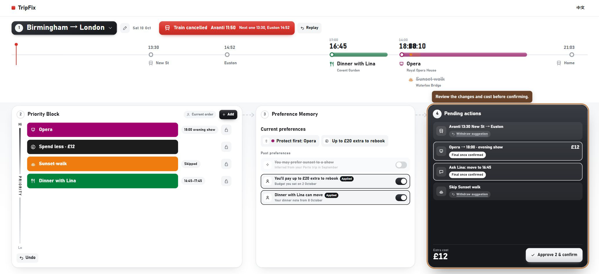

# TripFix: Who decides what survives a disrupted trip?

Word count: 1133 (165 abstract and 968 main text, including the rationale table and headings).

## Abstract

When a train is cancelled, the order of activities in an itinerary says little about which one the traveller would most regret losing. TripFix is a browser prototype for repairing a disrupted day trip while keeping that judgement in the traveller’s hands. Priority Blocks let the traveller rank activities alongside spending and lock requirements that must be met. A memory display distinguishes current choices from earlier preferences, shows where the earlier information came from and lets the traveller decide whether it still applies. A local planner calculates a revised itinerary and presents its consequences before confirmation. In a London walkthrough, protecting the full opera led to a £12 evening performance. Requiring the full performance at no extra cost exposed a conflict. Releasing the opera lock produced a £0 alternative with interval admission. The prototype supports repeated corrections after one simulated disruption. Trains, fares and external bookings are simulated. The walkthrough establishes how the system responds to those choices. Traveller comprehension remains an open evaluation question.

## 1. Design rationale and project scope

### Who decides what survives?

A traveller has booked an afternoon opera, arranged dinner with Lina and set aside half an hour for sunset by the river. All three fit until the outbound train is cancelled. Moving each activity later might preserve their sequence while losing the one experience that mattered most: walking by the river in daylight. Even with perfect timetable information, the system cannot read that priority from a calendar. Our design question was how a traveller could express the sacrifice they were willing to make, see how the repair reflected it and change their mind before committing.

Assignment 1 brought together two bodies of evidence. TripTide found that language models often preserved an itinerary’s intent and sequence, but handled disruptions less successfully as itineraries grew longer [1]. Zhou and colleagues studied when people should check a multistep agent’s work. Of 48 participants, 39 preferred intermediate checks to confirmation at the end [2]. The first study evaluates revised plans. The second concerns opportunities to intervene in other tasks. Together they motivate our decision to let people inspect the basis of a revision while the consequences can still change. Neither study establishes which priority a particular traveller holds. We therefore give that decision an explicit place in the interaction.

### Four decisions that shaped the interaction

| Design choice | Why it suits the problem | Evidence behind the choice | Status |
|---|---|---|---|
| Priority Blocks with separate locks | Dragging a block expresses which activity to protect first. Locking it makes full preservation a condition of any acceptable plan. Someone who prefers the opera but could accept missing the first act can express exactly that distinction. | Week 2 showed the same flight choices presented aloud and on screen. Visible alternatives support recognition and comparison [4]. We removed percentage labels and variable lengths from an earlier version because neither had a defined meaning for the traveller’s choice. | Implemented |
| A memory display with source and control | A past preference for sunset may be a poor guide to today’s trip. The panel separates current priorities from earlier information, identifies an inferred preference or the traveller’s own note, and lets them turn it off. A manual reorder takes precedence over the inferred order. | The Week 2 thermostat example shows why a manual override must last. Week 4 asks people to be able to inspect and correct remembered information [4, 6]. These principles also connect to efficient correction in Amershi and colleagues’ guidelines [3]. | Implemented. Example histories are seeded. |
| Automatic replanning with a conflict check | Working out which train and performance fit is a scheduling task. Choosing whether to spend money or miss part of a performance is a personal decision. A conflict stops confirmation and invites the traveller to release a lock. | Week 1’s mixed-initiative example assigns the next move according to the cost of a wrong guess [4]. Week 3’s exercise on checkable criteria informed a concrete rule: whenever locked requirements conflict, confirmation must be unavailable [5]. | Implemented |
| Preview individual consequences before commitment | Approving a different train can also mean abandoning the walk or asking Lina to move dinner. Pending actions names each change, shows the extra cost and marks actions that become final on confirmation. Eligible changes can be withdrawn individually. | Week 4 distinguishes visible, reversible actions from consequential actions that need confirmation [6]. During development we replaced a passive reversibility label with a working withdrawal control, so a traveller can act on that information. | Local controls implemented. External effects simulated. |

The distinction between reviewing preferences and approving actions emerged during development. An earlier prototype already offered a preview and undo. A preview can show that dinner moved, but it leaves the traveller to guess whether the cause was a timetable constraint or an old assumption that dinner was flexible. In this version the traveller can inspect that assumption before reviewing the proposed change. They can leave a useful budget in place while correcting only the assumption that caused the problem.

## 2. Architecture and technical rationale

The local planner searches combinations of train services and activity slots. Arrival times, transfer gaps, budget and locks determine feasibility. Among feasible schedules it compares outcomes in the traveller’s stated order. This gives a block a precise meaning: moving it above another changes which outcome wins when both cannot be protected. A deterministic planner makes that decision reproducible with the same scenario and inputs. It also lets a reviewer inspect how one correction changes the proposal without supplying a model credential.

The browser saves order, locks and enabled memories for each trip. A proposed repair remains separate from the confirmed itinerary. Withdrawing an eligible suggestion excludes that option before recalculation, so the next proposal respects the correction. Confirmation updates the itinerary held in the current session and supplies the reference plan for subsequent changes.

We narrowed A1’s broader question about successive disruptions to repeated decisions after one cancellation. Keeping the event and inventory fixed lets the walkthrough isolate the effect of the traveller’s intervention. The screens record actual interface states. The cancellation, fares, past-trip examples and external booking or messaging effects are simulated. The next evaluation would ask travellers to predict the cost and identify the lost activity before confirming. That would test whether people understand the trade-off the planner has computed.

## 3. Storyboards and illustrated interaction

**Keeping the whole opera.** After the 11:50 cancellation, the traveller moves Opera above Spend less. TripFix offers the 18:00 performance for £12 extra and shows that the sunset walk would be skipped. Seeing both consequences lets the traveller decide whether a full performance is worth that sacrifice.

**Changing the terms.** The traveller locks the full opera and zero extra spending. TripFix reports a conflict and disables confirmation. The traveller then unlocks Opera while keeping the spending lock. Interval admission at 15:45 becomes feasible for £0, and confirmation becomes available again. Only one requirement had to change.

## References and project evidence

1. Karmakar, P., Chaudhuri, S., Mallick, S., Gupta, M., Jana, A. and Ghosh, S. (2026). [TripTide: A Benchmark for Adaptive Travel Planning under Disruptions](https://aclanthology.org/2026.findings-acl.2002/). Findings of ACL.
2. Zhou, J., Roy, A., Gupta, S., Weitekamp, D. and MacLellan, C. J. (2026). [When Should Users Check? Modeling Confirmation Frequency in Multi-Step Agentic AI Tasks](https://doi.org/10.1145/3772318.3790655). CHI.
3. Amershi, S. et al. (2019). [Guidelines for Human-AI Interaction](https://www.microsoft.com/en-us/research/publication/guidelines-for-human-ai-interaction/). CHI.
4. University of Birmingham, Intelligent Interactive Systems (2026). [Lecture 3, slides 9–10](https://canvas.bham.ac.uk/courses/90253/files/22437894), [Lecture 5, slides 8 and 11](https://canvas.bham.ac.uk/courses/90253/files/22460079), [Lecture 6, slide 13](https://canvas.bham.ac.uk/courses/90253/files/22460081).
5. University of Birmingham, Intelligent Interactive Systems (2026). [Lecture 9, slides 12–14](https://canvas.bham.ac.uk/courses/90253/files/22503236).
6. University of Birmingham, Intelligent Interactive Systems (2026). [Lecture 10, slide 12](https://canvas.bham.ac.uk/courses/90253/files/22507964), [Lecture 12, slides 12 and 16](https://canvas.bham.ac.uk/courses/90253/files/22507966).

[Reviewed implementation, 82dc02b](https://github.com/THRIDX/TripFix/tree/82dc02b3af5b080f1bdea3720f7100df071f49ca/TripFix) · [Prototype README and development record](README.md) · [Repository](https://github.com/THRIDX/TripFix)