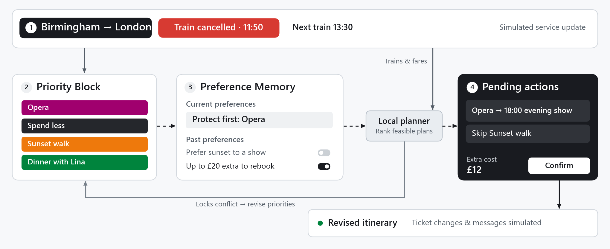
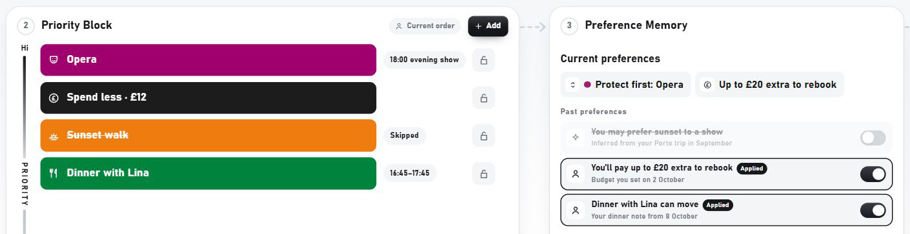
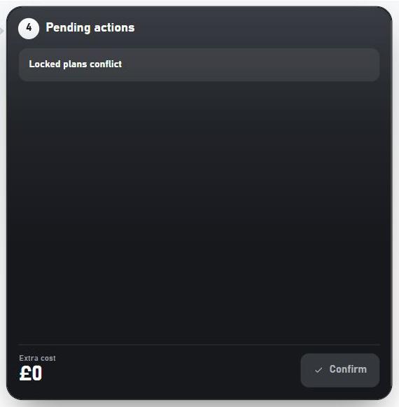
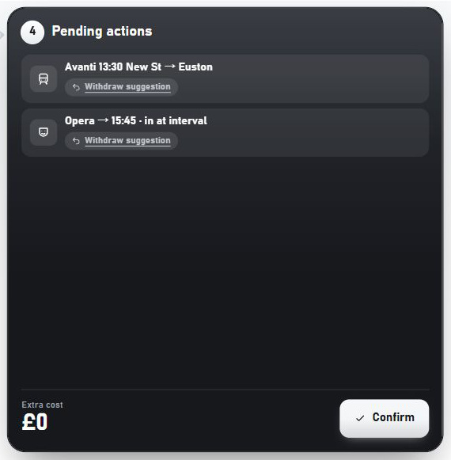

# TripFix: Who decides what survives a disrupted trip?

Word count: 1155 (151 abstract and 1004 main text, including the rationale table and headings).

## Abstract

A cancelled train leaves a traveller with a choice: pay £12 to see the whole opera that evening, or spend nothing extra and arrive at the interval. A timetable can show which options are possible. Only the traveller can say which is worth taking.

TripFix helps travellers make that choice through two controls. In **Priority Block**, they rank what matters today and lock anything they must keep. In **Preference Memory**, they see what the system remembers, where each preference came from and whether it still applies. A traveller who usually puts sunset first can choose the opera today and keep their usual spending limit. The planner then shows the revised day, including what it would cost and what they would miss, before they confirm. We built and tested this interaction in a browser using a simulated train cancellation, fares and bookings. The walkthrough follows one disruption through several changes of mind.

## 1. Design rationale and project scope

### What is the traveller trying to keep?

On the original itinerary, the opera comes first, dinner with Lina comes next and the walk by the river comes last. That order makes sense while everything runs on time. Once the train is cancelled, moving the walk to 20:15 still leaves a slot labelled “walk”, but the sun will have set. Equally, the traveller may be happy to miss the walk if it means hearing the opening of the opera. The order of the day tells us little about which loss matters more. How can a traveller make that judgement visible, and correct the system if it carries yesterday’s preference into today’s plan?

Assignment 1 brought together two bodies of evidence. TripTide found that language models often preserved an itinerary’s intent and sequence, but handled disruptions less successfully as itineraries grew longer [1]. Zhou and colleagues studied when people should check a multistep agent’s work. Of 48 participants, 39 preferred intermediate checks to confirmation at the end [2]. The first study evaluates revised plans. The second concerns opportunities to intervene in other tasks. Together they suggest a place to intervene: after the disruption, while the traveller can still change what the repair protects.

### Two core designs: Priority Block and Preference Memory

**Priority Block** gives the traveller a way to say what matters on this trip. **Preference Memory** lets them check what the system has carried forward. The distinction matters when the two disagree. A traveller can move Opera above Sunset walk, see the old sunset preference switch off, and keep the £20 rebooking limit they still want.

| Design choice | Why it suits the problem | Evidence behind the choice | Status |
|---|---|---|---|
| **Priority Block**: rank and lock | Dragging a block expresses which activity to protect first. Locking it makes full preservation a condition of any acceptable plan. Someone who prefers the opera but could accept missing the first act can express exactly that distinction. | Week 2 showed the same flight choices presented aloud and on screen. Visible alternatives support recognition and comparison [4]. We removed percentage labels and variable lengths from an earlier version because neither had a defined meaning for the traveller’s choice. | Implemented |
| **Preference Memory**: inspect and correct | A past preference for sunset may be a poor guide to today’s trip. The panel separates current priorities from earlier information, identifies an inferred preference or the traveller’s own note, and lets them turn it off. A manual reorder takes precedence over the inferred order. | The Week 2 thermostat example shows why a manual override must last. Week 4 calls for memory people can inspect and correct [4, 6]. These principles also connect to efficient correction in Amershi and colleagues’ guidelines [3]. | Implemented. Example histories are seeded. |
| Replanning and conflict feedback | Working out which train and performance fit is a scheduling task. Choosing whether to spend money or miss part of a performance is a personal decision. A conflict stops confirmation and invites the traveller to release a lock. | Week 1’s mixed-initiative example assigns the next move according to the cost of a wrong guess [4]. Week 3’s exercise on checkable criteria informed a concrete rule: whenever locked requirements conflict, confirmation must be unavailable [5]. | Implemented |
| Preview individual consequences before commitment | Approving a different train can also mean abandoning the walk or asking Lina to move dinner. The Pending actions card names each change, shows the extra cost and marks actions that become final on confirmation. Eligible changes can be withdrawn individually. | Week 4 distinguishes visible, reversible actions from consequential actions that need confirmation [6]. During development we replaced a passive reversibility label with a working withdrawal control, so a traveller can act on that information. | Local controls implemented. External effects simulated. |

An earlier prototype offered a preview and undo. When it moved dinner, the preview showed the new time but left a question unanswered: was that the only time the train allowed, or had TripFix used an old note that dinner could move? This led us to put Preference Memory between ranking and confirmation. The traveller can turn off the dinner note before deciding whether the revised evening works.

## 2. Architecture and technical rationale

Priority Block supplies the traveller’s ranking and locks. Preference Memory shows the budget and flexibility settings in effect. The local planner combines these inputs with the available trains and activity slots. Arrival times, transfer gaps, budget and locks determine feasibility. Among feasible schedules it compares outcomes in the traveller’s stated order. When activities compete, moving one block up can change which plan wins. A reviewer can repeat the decision with the same inputs or change one requirement to see its effect.

The browser saves order, locks and enabled memories for each trip. A proposed repair remains separate from the confirmed itinerary. Withdrawing an eligible suggestion excludes that option before recalculation, so the next proposal respects the correction. Confirmation updates the itinerary held in the current session and supplies the reference plan for subsequent changes.

We narrowed A1’s broader question about successive disruptions to repeated decisions after one cancellation. Keeping the event and inventory fixed lets the walkthrough isolate the effect of the traveller’s intervention. The screens record actual interface states. The cancellation, fares, past-trip examples and external booking or messaging effects are simulated. The next evaluation would ask travellers to predict the cost and identify the lost activity before confirming. That would test whether people understand the trade-off the planner has computed.

## 3. Storyboards and illustrated interaction

**Keeping the whole opera.** After the 11:50 cancellation, the traveller puts Opera first in Priority Block. Preference Memory shows that the old sunset preference is off and the £20 budget still applies. The 18:00 performance costs £12 extra and means missing the walk. The traveller sees both consequences before committing.

**Changing the terms.** The traveller locks the full opera and zero extra spending. TripFix reports a conflict and disables confirmation. The traveller then unlocks Opera while keeping the spending lock. Interval admission at 15:45 becomes feasible for £0, and confirmation becomes available again. Only one requirement had to change.

| Both requirements locked | Opera unlocked, £0 limit retained |
|---|---|
|  |  |

## References and project evidence

1. Karmakar, P., Chaudhuri, S., Mallick, S., Gupta, M., Jana, A. and Ghosh, S. (2026). [TripTide: A Benchmark for Adaptive Travel Planning under Disruptions](https://aclanthology.org/2026.findings-acl.2002/). Findings of ACL.
2. Zhou, J., Roy, A., Gupta, S., Weitekamp, D. and MacLellan, C. J. (2026). [When Should Users Check? Modeling Confirmation Frequency in Multi-Step Agentic AI Tasks](https://doi.org/10.1145/3772318.3790655). CHI.
3. Amershi, S. et al. (2019). [Guidelines for Human-AI Interaction](https://www.microsoft.com/en-us/research/publication/guidelines-for-human-ai-interaction/). CHI.
4. University of Birmingham, Intelligent Interactive Systems (2026). [Lecture 3, slides 9–10](https://canvas.bham.ac.uk/courses/90253/files/22437894), [Lecture 5, slides 8 and 11](https://canvas.bham.ac.uk/courses/90253/files/22460079), [Lecture 6, slide 13](https://canvas.bham.ac.uk/courses/90253/files/22460081).
5. University of Birmingham, Intelligent Interactive Systems (2026). [Lecture 9, slides 12–14](https://canvas.bham.ac.uk/courses/90253/files/22503236).
6. University of Birmingham, Intelligent Interactive Systems (2026). [Lecture 10, slide 12](https://canvas.bham.ac.uk/courses/90253/files/22507964), [Lecture 12, slides 12 and 16](https://canvas.bham.ac.uk/courses/90253/files/22507966).

[Reviewed implementation, e0e7804](https://github.com/THRIDX/TripFix/tree/e0e78042d7ef5fb997cf738df9df9d84f86e4075/TripFix) · [Prototype README and development record](README.md) · [Repository](https://github.com/THRIDX/TripFix)